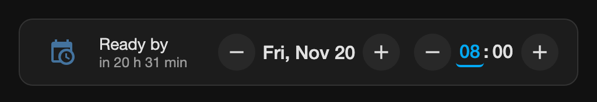
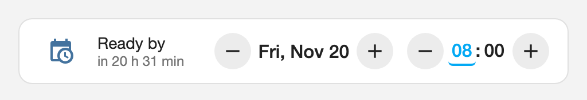
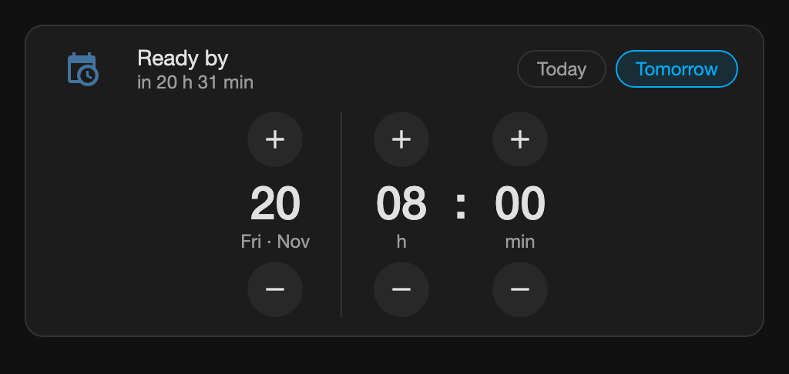
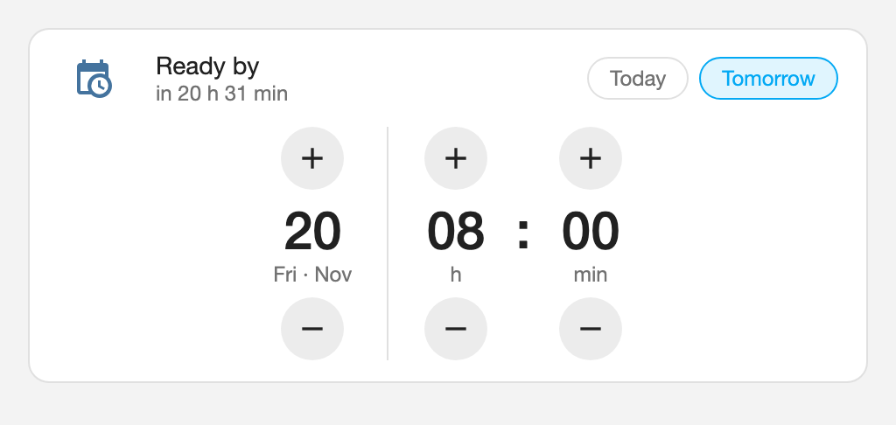

# DateTime Stepper Card

A Home Assistant Lovelace card to set a date and time with **plus and minus buttons** instead of a date picker and text fields. Built for touch screens and wall tablets: one tap per step, press and hold to keep stepping.

Works with `input_datetime` helpers (date + time, date only, time only) and `datetime` entities from integrations.

## Layouts

**`row`**: a single compact line that fits where a regular entity row would go. Tap the hours or the minutes to choose what the time `−`/`+` buttons change.




**`card`**: large stepper columns for day, hour and minute, with optional Today/Tomorrow buttons.




## Features

- Steps work on the full date and time: `−` on 00:00 goes to 23:45 of the previous day.
- Minutes snap to the configured step (08:07 + 15 min → 08:15).
- Press and hold a button to repeat, speeding up the longer you hold.
- Saves after a short pause (default 1 s), so several taps send one service call.
- Shows the time remaining ("in 13 h 20 min"); turns red when the time is in the past.
- Optionally blocks times in the past.
- Follows your Home Assistant theme, language, 12/24-hour setting and time zone preference.
- Visual editor in the dashboard UI.
- English and Dutch translations.

## Installation

### HACS (custom repository)

1. In HACS, open the menu (⋮) → **Custom repositories**.
2. Add `https://github.com/WorlockM/datetime-stepper-card` with type **Dashboard**.
3. Install **DateTime Stepper Card** and reload your browser.

### Manual

1. Download `datetime-stepper-card.js` from the [latest release](https://github.com/WorlockM/datetime-stepper-card/releases/latest).
2. Copy it to `config/www/`.
3. Add it as a dashboard resource: **Settings → Dashboards → ⋮ → Resources**, URL `/local/datetime-stepper-card.js`, type **JavaScript module**.

## Configuration

```yaml
type: custom:datetime-stepper-card
entity: input_datetime.car_ready_by
name: Ready by
icon: mdi:car-clock
layout: card
minute_step: 15
quick_buttons:
  - today
  - tomorrow
```

| Option          | Type    | Default          | Description                                                              |
| --------------- | ------- | ---------------- | ------------------------------------------------------------------------ |
| `entity`        | string  | **required**     | An `input_datetime` or `datetime` entity.                                |
| `name`          | string  | friendly name    | Name shown on the card.                                                  |
| `icon`          | string  | entity icon      | Icon shown on the card.                                                  |
| `layout`        | string  | `card`           | `row` (compact) or `card` (large buttons).                               |
| `minute_step`   | number  | `15`             | Minutes per step; minutes snap to multiples of this value.               |
| `hour_step`     | number  | `1`              | Hours per step.                                                          |
| `commit_delay`  | number  | `1000`           | Milliseconds to wait after the last tap before saving. `0` saves on every tap. |
| `show_relative` | boolean | `true`           | Show the time remaining under the name (date + time entities only).      |
| `quick_buttons` | list    | none             | Any of `today`, `tomorrow`.                                              |
| `allow_past`    | boolean | `true`           | Set to `false` to stop the value from going before now.                  |

Tapping the name or icon opens the entity's more-info dialog.

### Theming

The card uses the standard Home Assistant theme variables. You can override these with [card-mod](https://github.com/thomasloven/lovelace-card-mod) or your theme:

| Variable               | Default                           |
| ---------------------- | --------------------------------- |
| `--dsc-button-size`    | `36px`                            |
| `--dsc-button-color`   | `--secondary-background-color`    |
| `--dsc-accent`         | `--state-icon-color`              |

## Development

```bash
npm install
npm run build      # dist/datetime-stepper-card.js
npm run watch      # rebuild on change
npm run typecheck
```

`dev/index.html` is a standalone harness with a mocked `hass` object. Build it with `npm run harness` and serve the `dev` folder, for example with `python3 -m http.server --directory dev`.

The README screenshots come from `dev/screenshot.html?layout=row|card&theme=dark|light`, rendered at 512 px wide with a device scale factor of 2.

## License

MIT
